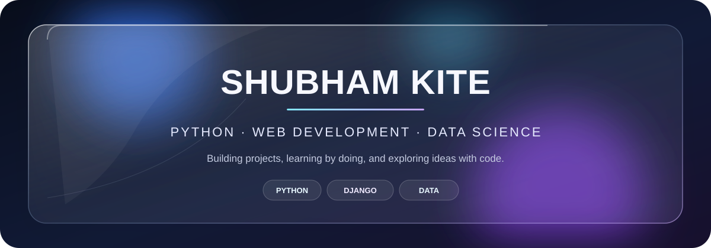

---

## 👋 About me

- 🐍 I enjoy working with **Python** and exploring **data science**.
- 🌐 I build web projects with **Django** and the web stack.
- 📚 I like learning by building practical projects.

## 🛠️ Tech stack

## 🚀 Featured projects

| Project | What it is |
| --- | --- |
| [📚 Online Library](https://github.com/Shubham-kite/Online-Library) | A Django library web app with user registration and login. |
| [📈 Stonk](https://github.com/Shubham-kite/Stonk) | A simple app that provides stock information. |
| [📊 DataScience-](https://github.com/Shubham-kite/DataScience-) | Python code and notebooks related to data science. |

## 📊 GitHub at a glance

---

*Thanks for visiting — feel free to explore my repositories!*

